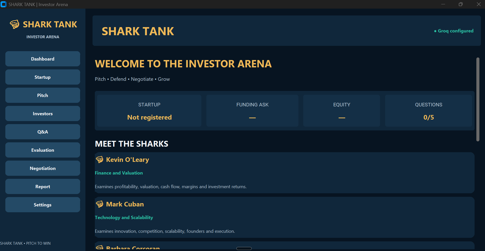
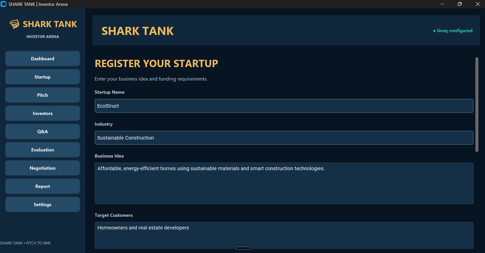
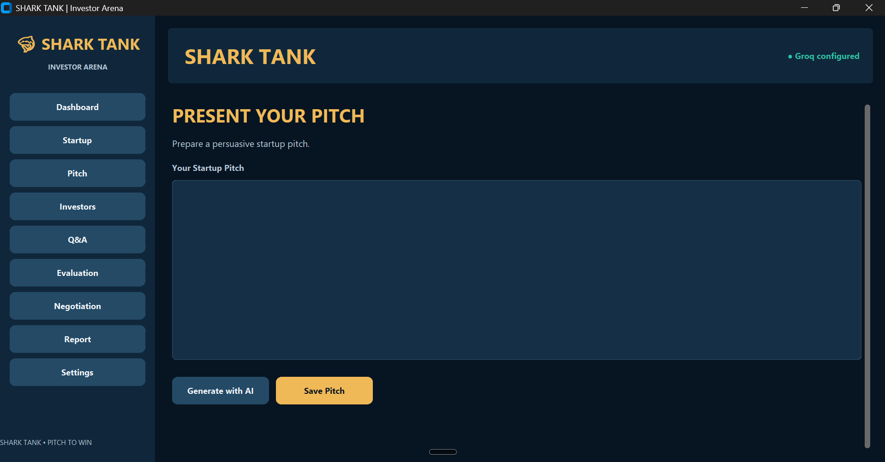
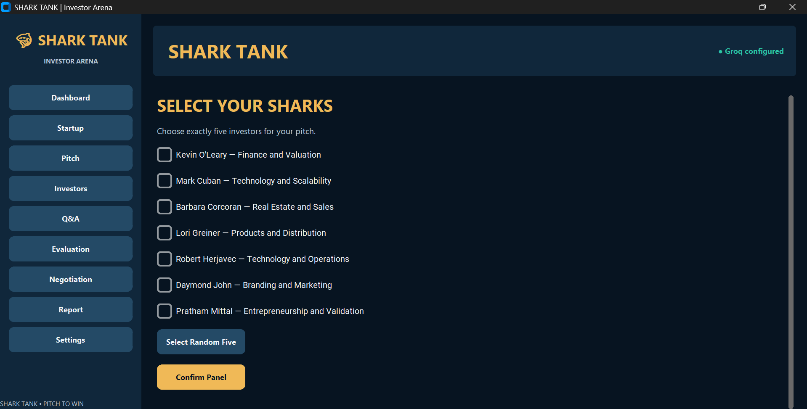
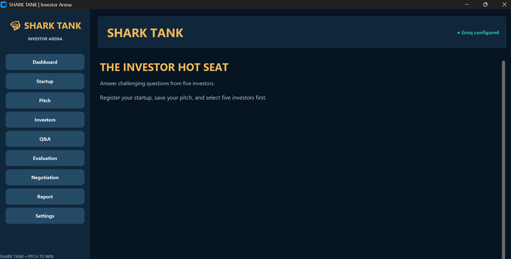
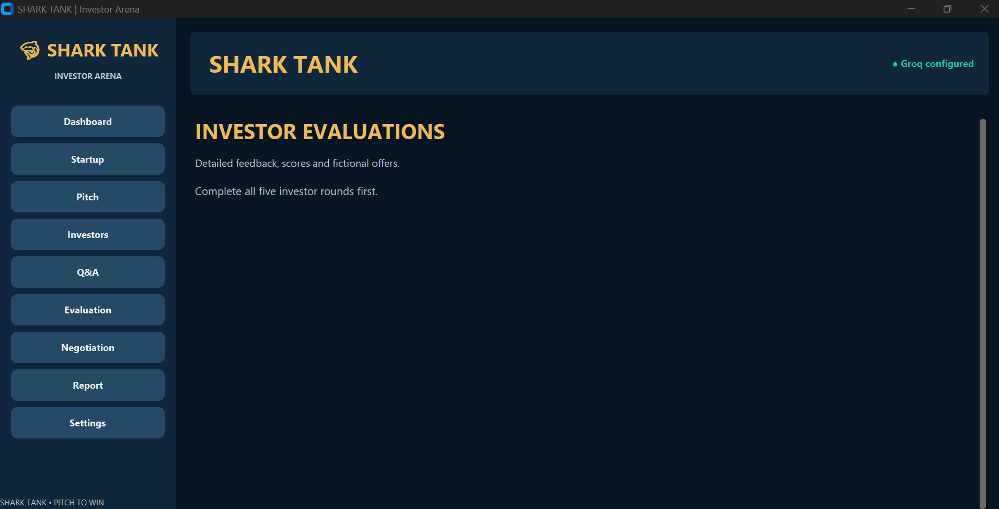
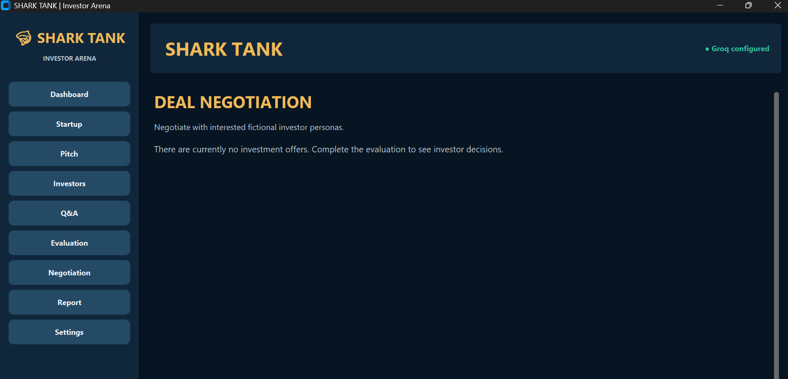
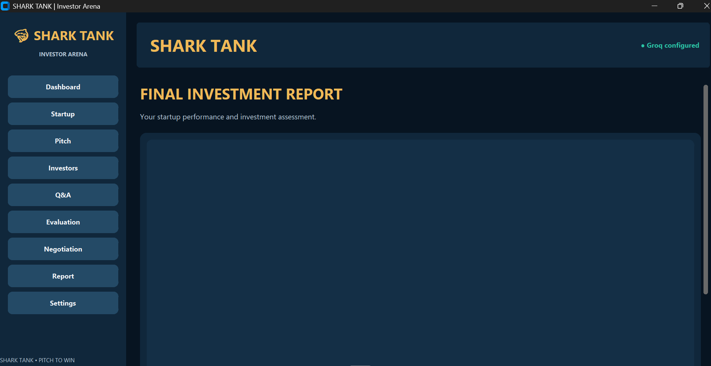
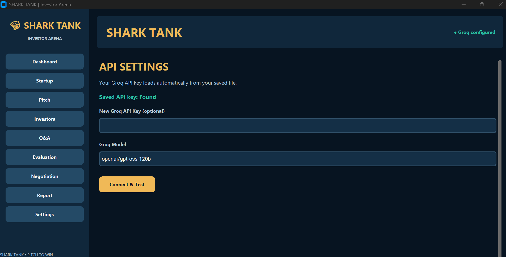

# 🦈 **Shark Tank – Startup Investment&#x20;**

### **Pitch Your Idea. Defend Your Business. Negotiate Your Deal.**

Shark Tank is an interactive startup investment simulator developed using Python, designed to recreate the experience of presenting a business idea to a panel of investors. The application allows users to develop startup pitches, respond to challenging investor questions, analyze financial decisions, and negotiate fictional investment deals.

The project combines **software development, entrepreneurship, financial analysis, and business strategy** into a practical learning experience. It encourages users to think critically about their business ideas while developing an understanding of investment decisions, startup valuations, and entrepreneurial challenges.

---

## About the Project

Starting a business involves more than developing an innovative idea. Entrepreneurs must understand their target market, identify potential competitors, justify their financial projections, and convince investors that their business has the potential to succeed.

This project was developed to simulate these challenges through an interactive desktop application.

Users begin by registering their startup and providing essential business information, including their industry, revenue model, target customers, investment requirements, and equity offerings. They then prepare a pitch and present their business to a panel of five investors selected from seven available profiles.

Throughout the simulation, investors challenge the entrepreneur with questions relating to financial feasibility, scalability, market demand, profitability, and business strategy.

The application evaluates the responses, provides individual investor feedback, generates fictional investment decisions, and allows users to negotiate potential deals.

At the end of the simulation, users receive a comprehensive report highlighting their overall performance, business strengths, weaknesses, and potential improvements.

---

## Key Features

### 1. Registration

Users can create a startup profile by entering information such as:

- Startup name and industry
- Description of the business idea
- Target customers and market
- Business and revenue models
- Current revenue or business stage
- Investment amount requested
- Percentage of equity offered

The application also calculates the implied post-money valuation based on the investment requested and the equity offered.

### 2. Pitch Preparation

Users can prepare and refine a startup pitch before interacting with investors.

The pitch serves as the foundation for the simulation and helps investors understand the business concept, proposed solution, and funding requirements.

A pitch-generation feature is also available to help users structure their presentations using the business information they provide.

### 3. Investor Selection

The application includes seven investor profiles, each specializing in different areas of business.

Users select exactly five investors to form their panel or use the random selection feature.

This allows entrepreneurs to experience different perspectives when presenting their businesses.

### 4. Q/A

Each investor asks a question related to their area of expertise.

Questions may focus on:

- Financial projections and profitability
- Market size and customer demand
- Competition and differentiation
- Product development and distribution
- Scalability and operational efficiency
- Marketing and customer acquisition
- Investment valuation and risk

Users can also request follow-up questions, encouraging them to justify their decisions and explain their business strategies in greater detail.

### 5. Evaluation

After completing the five investor rounds, the application evaluates the entrepreneur's responses.

Each investor provides:

- A performance score out of 10
- Strengths demonstrated by the entrepreneur
- Weaknesses or areas requiring improvement
- Primary investment concerns
- An investment decision and its reasoning
- A fictional investment offer, where applicable

The application combines the individual scores into an overall score out of 50.

### 6. Investment Negotiation

Investors who express interest may present fictional investment offers.

Users can respond by proposing alternative investment amounts, equity percentages, or other deal terms.

The negotiation feature allows entrepreneurs to explore how funding decisions affect business ownership and investment relationships.

### 7. Detailed Performance Reports

At the end of the simulation, users can generate a structured investment report covering:

1. Executive summary
2. Startup overview
3. Individual investor evaluations
4. Financial and valuation assessment
5. Investment offers and negotiations
6. Business strengths and weaknesses
7. Practical recommendations
8. Final conclusion

Reports can be saved locally in text or Markdown format for future reference.

### 8. Session Management

Users can save their simulation progress in JSON format and reload it later.

This allows them to preserve startup details, investor questions, responses, evaluations, negotiations, and reports without restarting the entire process.

---
## Application Outputs

The following screenshots showcase the user interface and different stages of the Shark Tank – Startup Investment application.

### 1. Dashboard
The main dashboard provides an overview of the application, startup information, funding requirements, and available investor profiles.



### 2. Startup Registration
Users can register their business by providing the startup name, industry, business concept, target customers, and funding details.



### 3. Pitch Preparation
The pitch preparation interface allows users to create, edit, and save their business presentations. Users can manually write a pitch outlining their startup's business idea, target market, revenue model, and investment requirements.

For users who do not have a properly structured pitch or are unsure how to present their business idea, the application provides a Generate with AI feature. This automatically creates a structured startup pitch based on the business information provided during registration.

Users can then review, customize, and save the generated pitch before presenting it to their selected investors.



### 4. Investor Selection
Users can select five investors from seven available profiles, each specializing in different areas of business.



### 5. Investor Q&A
The interactive questioning section allows entrepreneurs to respond to business-related questions from their selected investors.



### 6. Investor Evaluation
The evaluation section provides investor-specific feedback, performance scores, and fictional investment decisions after completing the questioning rounds.



### 7. Deal Negotiation
The negotiation interface allows entrepreneurs to review fictional investment offers and negotiate potential deal terms.



### 8. Final Investment Report
The reporting section displays the startup's overall assessment, investor evaluations, and recommendations after the simulation is completed.



### 9. Application Settings
The settings interface allows users to configure and test the application's API connection.



----
## Technologies Used

| Technology       | Purpose                                                    |
| ---------------- | ---------------------------------------------------------- |
| Python           | Core application logic and development                     |
| CustomTkinter    | Modern desktop graphical interface                         |
| Groq API         | Investor interactions, questioning, and evaluations        |
| JSON             | Saving and restoring simulation sessions                   |
| Threading        | Background processing to maintain interface responsiveness |
| Queue            | Handling background responses within the application       |
| python-dotenv    | API key configuration                                      |
| Jupyter Notebook | Development and execution environment                      |
| Tkinter          | Dialog boxes and file management                           |

### Implementation

The application uses an object-oriented structure, with the main interface implemented through a Python class.

CustomTkinter provides the desktop interface, including navigation menus, text fields, investor selection controls, and report displays.

Investor questions, evaluations, and negotiations are processed through API requests. Background threads handle these requests, while a queue transfers completed responses back to the interface, helping prevent the application from freezing during processing.

JSON is used to organize and store simulation data, including startup profiles, investor selections, questions, responses, and evaluation results.

The application also includes input validation, error handling, and report formatting to improve usability.

---

## Installation and Setup

### Prerequisites

Before running the application, ensure that you have:

- Python 3.10 or newer
- Jupyter Notebook or JupyterLab
- An internet connection
- A Groq API key
- A desktop environment capable of displaying Tkinter windows

### Step 1: Clone the Repository

```bash
git clone https://github.com/YOUR_USERNAME/YOUR_REPOSITORY.git
cd YOUR_REPOSITORY
```

Replace the placeholder with your actual GitHub repository URL.

### Step 2: Install Dependencies

Open your terminal or command prompt and run:

```bash
pip install customtkinter groq python-dotenv notebook
```

### Step 3: Launch Jupyter Notebook

```bash
jupyter notebook
```

Open the file:

`Shark_Tank_Investor_Simulator_Updated.ipynb`

### Step 4: Configure the API

1. Visit [Groq Console](https://console.groq.com/).
2. Create an API key.
3. Run the API setup cell in the notebook.
4. Enter your API key when prompted.
5. Verify that the connection test returns a successful response.

The application can also load a key from `.shark_tank.env` in the user's home directory.

### Step 5: Run the Application

Execute the main application cell.

A separate desktop window titled **SHARK TANK | Investor Arena** will open, displaying the dashboard and available features.

---

## How the Simulation Works

The application follows a structured investment simulation process.

**Stage 1 – Registration**

The entrepreneur enters the startup's essential details, including its business concept, revenue model, funding request, and equity offering.

**Stage 2 – Pitch Development**

The entrepreneur prepares a business pitch explaining the startup's purpose, market opportunity, and proposed business strategy.

**Stage 3 – Investor Panel Selection**

Five investors are selected to evaluate the business from different commercial perspectives.

**Stage 4 – Q/A&#x20;**

The entrepreneur answers questions about business feasibility, financial decisions, customer demand, and long-term growth.

**Stage 5 – Evaluation**

Investors assess the entrepreneur's responses and provide scores, feedback, and fictional investment decisions.

**Stage 6 – Deal Negotiation**

The entrepreneur can negotiate with interested investors and explore alternative deal structures.

**Stage 7 – Final Report**

The application generates a detailed assessment summarizing the startup's performance and identifying areas for improvement.

---

## Investor Profiles

| Investor         | Primary Area of Focus                                     |
| ---------------- | --------------------------------------------------------- |
| Kevin O'Leary    | Finance, valuation, profitability, investment returns     |
| Mark Cuban       | Technology, innovation, competition, scalability          |
| Barbara Corcoran | Real estate, sales, customer demand                       |
| Lori Greiner     | Product development, consumer needs, distribution         |
| Robert Herjavec  | Technology, operations, execution                         |
| Daymond John     | Branding, marketing, customer acquisition                 |
| Pratham Mittal   | Entrepreneurship, customer validation, sustainable growth |

These are fictional investor personas inspired by publicly known business personalities, not representations of actual conversations with those individuals.

---

## Financial Concepts Explored

One of the project's main objectives is to introduce users to financial concepts commonly encountered when seeking startup investment.

### Startup Valuation

The application calculates the implied post-money valuation using:

**Post-Money Valuation = Investment Requested ÷ (Equity Offered / 100)**

For example, suppose an entrepreneur requests ₹50,00,000 in exchange for 10% equity.

The implied post-money valuation would be:

₹50,00,000 ÷ 0.10 = **₹5,00,00,000 (₹5 crore)**

This calculation helps users understand the relationship between investment amounts, ownership percentages, and business valuations.

### Equity and Ownership

The simulator allows entrepreneurs to explore the consequences of offering ownership in exchange for capital.

A higher equity percentage generally means giving up a larger ownership stake, while a lower equity percentage may require a stronger justification for the startup's valuation.

### Investment Feasibility

Investor evaluations consider business factors such as revenue, profitability, customer demand, scalability, competition, and execution risks.

These assessments are part of an educational simulation rather than verified financial forecasts.

---

## Project Objectives

This project was developed to explore the relationship between computer programming, finance, and entrepreneurship.

The primary objectives include:

- Developing a functional desktop application using Python.
- Creating an interactive environment for practicing startup pitches.
- Understanding startup valuation and equity negotiations.
- Encouraging structured financial and strategic thinking.
- Exploring how different investors assess business opportunities.
- Improving the presentation and evaluation of business ideas.
- Applying programming concepts to a practical business-oriented project.

The project also provided opportunities to work with graphical interfaces, external APIs, asynchronous processing, data validation, and local file management.

---

## Future Improvements

Potential future developments include:

- **Financial Dashboard:** Interactive visualizations of valuations, funding requirements, and equity distribution.
- **Pitch History:** Compare results from multiple simulation attempts.
- **Startup Valuation Calculator:** Additional methods for evaluating business worth.
- **Expanded Investor Profiles:** Introduce more business specializations and investment perspectives.
- **Performance Analytics:** Visualize strengths and weaknesses across different investor evaluations.
- **Improved Report Exporting:** Support formatted PDF reports.
- **Enhanced User Experience:** Additional interface customization and navigation improvements.

---

## Educational Purpose and Disclaimer

Shark Tank – Startup Investment Simulator is an independent educational software project.

It is not affiliated with, sponsored by, or endorsed by the television program *Shark Tank*, its producers, or any individuals whose public business approaches inspired the investor profiles.

All investor conversations, evaluations, negotiations, and investment offers are fictional simulations.

The application is intended for learning and experimentation and should not be used as a substitute for professional financial, legal, or investment advice.

---

## License

This project is distributed under the **MIT License**, permitting use, modification, and distribution subject to the license conditions.

See the `LICENSE` file for more information.

---

## Author

**Shreyan Jain | Adarsh V | Srikar Sai Pasupuleti | Vishnu Sai Tejas | Rishav Ashok Kumar | Daksh A**
